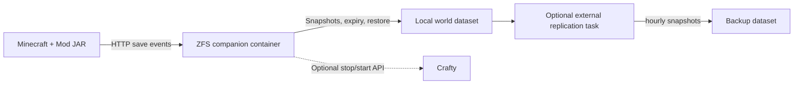

# Minecraft ZFS Backup

**English** | [简体中文](README.zh-CN.md)

A server-side Minecraft Mod that creates ZFS recovery points after completed world saves, with a separate Docker companion for ZFS operations. Start with local backups; add storage replication and Crafty-assisted rollback when needed.

**Current Mod:** 2.3.0 · **Minecraft:** 1.21.1 · **NeoForge:** 21.1.251 · **Java:** 21

- [How it works](#how-it-works)
- [Requirements](#requirements)
- [Quick start](#quick-start)
- [Configuration reference](#configuration-reference)
- [Commands and rollback](#commands-and-rollback)
- [Audit and persistent state](#audit-and-persistent-state)
- [Optional replication](#optional-replication)
- [Operations and troubleshooting](#operations-and-troubleshooting)
- [Development and further documentation](#development-and-further-documentation)

## How it works

Install the Mod JAR into the server's `mods/` directory. Deploy the companion with Docker Compose. The Mod observes successful native autosaves for live points and independently schedules complete hourly saves. After the supported save queues finish, it actively calls the companion's authenticated HTTP API. The companion creates local snapshots and handles their expiry.



| Snapshot family | Created when | Default local retention |
| --- | --- | --- |
| `mc-live-*` | After each successful native autosave, normally about every 5 minutes at 20 TPS | 1 hour, normally about 12 points |
| `mc-hourly-*` | Independent full-save scheduler: startup baseline, then UTC interval boundaries (hourly by default) | 24 hours, normally about 24 scheduled points |
| `mc-hourly-*` for manual, clean-stop and rollback recovery events | When the corresponding event succeeds | 24 hours; recovery holds can extend retention |

Live and hourly are distinct native snapshots with separate triggers and expiry times. Live observes the completed native autosave without serializing again. Hourly actively forces a complete save and flush, then waits for the supported player/chunk/entity/POI queues, even if native autosave is disabled. An independent Mod scheduler requests a baseline after startup, then uses UTC interval boundaries; successful live/manual checkpoints do not reset that timer. Pending hourly work has priority over a new live capture, and failed hourly work remains due for retry. Gameplay continues while HTTP requests are pending; new background save submissions are temporarily gated and saving flags are restored on completion or failure. Forced full saves and synchronous third-party save hooks can still delay a tick.

Live backups run without players by default, including worlds with forced-loaded chunks. Independent hourly backups always bypass the player-activity filter and restore prior disabled-saving flags after the forced capture. A verified clean shutdown can create a final hourly point; forced termination cannot deliver that shutdown event.

Expiry is based on actual ZFS creation time and persisted in snapshot user properties. The companion checks expiry on startup, after publication and independently at intervals of at most 60 seconds. It continues cleanup while Minecraft is stopped and resumes overdue cleanup after its own restart. Existing deadlines survive restarts and TTL configuration changes. Holds, rollback maintenance and busy snapshots can delay deletion; retention is by age rather than a hard count.

Deployment uses the Mod and Docker companion. There are no project-specific cron jobs, systemd units or shared-directory polling. TrueNAS and remote storage are optional.

## Requirements

| Component | Requirement |
| --- | --- |
| Game server | Dedicated Minecraft 1.21.1 server with NeoForge 21.1.251 and Java 21 |
| Host | Linux with OpenZFS 2.3 and `/dev/zfs` available |
| World storage | An existing, mounted ZFS dataset whose mount root is the world directory containing `level.dat` |
| Container runtime | Docker Engine and the `docker compose` plugin |
| Building the Mod | Java 21 JDK; the portable builder additionally requires Python 3.11+ |
| Optional one-click rollback | Crafty API integration; validated with Crafty 4.11.0, writable world bind and ZFS block cloning |

The companion image supplies Python 3.13 and ZFS 2.3 userspace tools; the host supplies the ZFS kernel module. See [validated versions and limits](docs/verification.md).

Each companion manages one configured world dataset. Prepare or migrate that dataset separately before deployment. The agent checks the exact mounted host path and does not create datasets. Child datasets, external databases and files outside this world dataset are outside its checkpoint scope. The whole Minecraft service directory, including BlueMap and configuration, can have a separate dataset and backup policy.

## Quick start

The example uses these host paths; replace them with your own existing paths and dataset name:

| Purpose | Example host value |
| --- | --- |
| Minecraft server directory | `/srv/minecraft` |
| Dedicated world dataset | `tank/minecraft-world` |
| World mount | `/srv/minecraft/world` |
| Companion configuration | `/srv/minecraft-backup/agent.json` |
| Durable companion state | `/srv/minecraft-backup/http-state` |
| Companion secrets | `/srv/minecraft-backup/secrets` |

Run the following from the repository root unless stated otherwise. Privileged file setup uses `sudo`; when already root, omit it. The ownership examples use Minecraft UID/GID `1000:1000`; substitute the actual game process IDs.

### 1. Get the source and build the Mod

```sh
git clone https://github.com/kevinmatthe/minecraft-zfs-backup.git
cd minecraft-zfs-backup

(cd mod && ./gradlew build)
```

The Gradle artifact is `mod/build/libs/local-zfs-backup-1.21.1-2.3.0.jar`.

Alternatively, compile and run the Java checks against an existing server's matching libraries:

```sh
python3 mod/build.py \
  --libraries-dir /srv/minecraft/libraries \
  --java /path/to/jdk-21/bin/java
```

If those libraries and the JDK are inside an existing game container:

```sh
python3 mod/build.py \
  --container YOUR_MINECRAFT_CONTAINER \
  --server-dir /path/to/server/inside/container
```

Both portable variants output `mod/build/local-zfs-backup-1.21.1-2.3.0.jar`. Install the resulting JAR into the server's `mods/` directory using its normal Mod installation procedure. Only the companion is deployed by this project's Compose file.

For the Gradle artifact, the example host installation is:

```sh
sudo install -m 0644 -o 1000 -g 1000 \
  mod/build/libs/local-zfs-backup-1.21.1-2.3.0.jar \
  /srv/minecraft/mods/local-zfs-backup-1.21.1-2.3.0.jar
```

For a portable build, use its `mod/build/` artifact path instead.

### 2. Prepare private configuration and tokens

These initialization commands are for a new installation; upgrades should preserve existing tokens and state.

```sh
sudo install -d -m 0700 /srv/minecraft-backup/secrets /srv/minecraft-backup/http-state
sudo install -m 0600 deploy/agent.example.json /srv/minecraft-backup/agent.json

sudo python3 - <<'PY'
import os
import secrets

fd = os.open('/srv/minecraft-backup/secrets/agent.token',
             os.O_WRONLY | os.O_CREAT | os.O_EXCL, 0o600)
with os.fdopen(fd, 'w') as output:
    output.write(secrets.token_hex(32) + '\n')
PY

sudo install -m 0600 -o 1000 -g 1000 \
  /srv/minecraft-backup/secrets/agent.token \
  /srv/minecraft/config/local-zfs-backup.token
sudo install -m 0644 -o 1000 -g 1000 \
  mod/local-zfs-backup.properties.example \
  /srv/minecraft/config/local-zfs-backup.properties
```

Edit `/srv/minecraft-backup/agent.json`: set `source_dataset` and every absolute path to match your host. The supplied local-only example is:

```json
{
  "live_ttl_seconds": 3600,
  "hourly_ttl_seconds": 86400,
  "source_dataset": "tank/minecraft-world",
  "world_path": "/srv/minecraft/world",
  "state_dir": "/srv/minecraft-backup/http-state",
  "api_token_file": "/srv/minecraft-backup/secrets/agent.token",
  "min_interval_seconds": 60,
  "listen_host": "0.0.0.0",
  "listen_port": 8765
}
```

The Mod and companion must have identical API token contents. Keep the companion configuration and tokens root-owned, mode `0600`, with state and secret directories mode `0700`. The Mod's token copy must be readable by the Minecraft user. Keep state and secrets outside the world dataset's restore scope.

### 3. Connect the private network

Create the shared Docker bridge:

```sh
docker network create minecraft-private
```

For a game server already running in Docker, add this external network to its existing Compose configuration, preserving its current networks. For example:

```yaml
services:
  minecraft:
    # Keep the existing image, volumes, ports and other settings.
    networks:
      - default
      - minecraft-backup
networks:
  default: {}
  minecraft-backup:
    external: true
    name: minecraft-private
```

Apply the network change through the game server's normal deployment procedure. For a temporary attachment to an existing container, `docker network connect minecraft-private YOUR_MINECRAFT_CONTAINER` also works; put the network in that service's Compose file for persistence across recreation.

The Mod's default URL is `http://minecraft-zfs-agent:8765`. The agent's world bind must retain the **exact absolute host path**, even if the game container uses a different path such as `/data/world`.

### 4. Start the companion

```sh
cp deploy/.env.example .env
```

Edit `.env` to match `agent.json`. For the local snapshot-only setup:

```dotenv
AGENT_CONFIG=/srv/minecraft-backup/agent.json
WORLD_PATH=/srv/minecraft/world
STATE_DIR=/srv/minecraft-backup/http-state
SECRETS_DIR=/srv/minecraft-backup/secrets
AGENT_NETWORK=minecraft-private
WORLD_READ_ONLY=true
```

```sh
docker compose --env-file .env -f deploy/compose.example.yaml config --quiet
docker compose --env-file .env -f deploy/compose.example.yaml up -d --build
docker compose --env-file .env -f deploy/compose.example.yaml ps
docker compose --env-file .env -f deploy/compose.example.yaml logs --tail 50 agent
```

Compose builds the companion locally. The example publishes no host API port. Only the companion receives `/dev/zfs` and its listed capabilities; Minecraft receives its usual Mod JAR and configuration.

Start or normally restart Minecraft after installing the Mod/configuration. Verify with `/zfsbackup status`, `/zfsbackup save` and `/zfsbackup list`. An independent full-save baseline is requested after startup; live points follow successful native autosaves. The scheduler creates current recovery points rather than backfilling history.

### Minecraft running directly on the host

Use the same world/configuration setup and companion network, but skip attaching a game container. Add this companion override, for example at `/srv/minecraft-backup/compose.host.yaml`:

```yaml
services:
  agent:
    ports:
      - "127.0.0.1:8765:8765"
```

Start with both Compose files:

```sh
docker compose --env-file .env -f deploy/compose.example.yaml \
  -f /srv/minecraft-backup/compose.host.yaml up -d --build
```

Set the Mod's `agent_url=http://127.0.0.1:8765`. The API is then reachable through host loopback; `/v1/` endpoints still require the shared token.

## Configuration reference

### Mod: `config/local-zfs-backup.properties`

```properties
agent_url=http://minecraft-zfs-agent:8765
agent_token_file=config/local-zfs-backup.token
freeze_timeout_seconds=15
hourly_interval_seconds=3600
only_if_players_been_online=false
snapshot_on_shutdown=true
```

| Property | Default | Meaning |
| --- | --- | --- |
| `agent_url` | `http://minecraft-zfs-agent:8765` | HTTP(S) origin; no credentials, query, fragment or non-root path |
| `agent_token_file` | `config/local-zfs-backup.token` | Regular token file; relative to the Minecraft server directory or an absolute path |
| `freeze_timeout_seconds` | `15` | Total prepare/save-barrier/snapshot budget, integer `1`–`15` seconds |
| `hourly_interval_seconds` | `3600` | Independent full-save interval, integer `60`–`31536000` seconds. Startup baseline, then UTC interval boundaries. |
| `only_if_players_been_online` | `false` | Apply a player-activity filter to live/clean-shutdown backups; independent hourly and manual saves bypass it. Keep `false` for unattended chunk activity. |
| `snapshot_on_shutdown` | `true` | Request an hourly snapshot after verified successful save/close, subject to the activity filter |
| `interval_seconds` | ignored | Legacy setting; native autosaves determine live frequency, and `hourly_interval_seconds` controls full backups |

Restart Minecraft after editing these properties. Booleans accept exactly `true` or `false`. Tokens must contain at least 32 printable non-space ASCII characters. TTLs are companion settings, separate from the save interval. The hourly timer uses monotonic deadlines; only an acknowledged hourly commit advances it. If a checkpoint fails, the due hourly work retries after backoff. A blocked game thread or failed storage cannot provide a successful forced-save backup.

### Companion: `agent.json`

| Field | Default | Meaning |
| --- | --- | --- |
| `source_dataset` | required | Fixed local world dataset, for example `tank/minecraft-world` |
| `world_path` | required | Exact absolute mounted host world path; contains `level.dat` |
| `state_dir` | required | Durable root-owned `0700` directory outside the restored world |
| `api_token_file` | required | Absolute path to the private API token outside the restored world |
| `live_ttl_seconds` | `3600` | Live snapshot lifetime; integer `1`–`315360000` seconds |
| `hourly_ttl_seconds` | `86400` | Hourly/manual/clean-stop/recovery lifetime; same range |
| `min_interval_seconds` | `60` | Minimum accepted interval per normal or scheduled-hourly request class; number `0`–`31536000`. A recent live does not rate-limit hourly. Does not schedule world saves. |
| `listen_host` | `0.0.0.0` | Companion listen interface inside its container |
| `listen_port` | `8765` | Integer `1`–`65535`; update the Mod URL and any optional port binding if changed |
| `crafty` | absent | Optional fixed Crafty integration; see below |
| `keep` | `24`, ignored | Deprecated compatibility field; must be a positive integer if present. Retention uses independent TTLs. |

Paths must be absolute and normalized. Unknown JSON configuration fields are rejected. Restart the companion after changes. A TTL change applies to newly initialized snapshots; persisted expiry on existing points remains unchanged. Older managed hourly points without expiry metadata receive their actual creation time plus the hourly TTL.

### Compose: `.env`

| Variable | Meaning |
| --- | --- |
| `AGENT_CONFIG` | Absolute host path to the private JSON configuration |
| `WORLD_PATH` | World bind source and target; matches JSON `world_path` |
| `STATE_DIR` | State bind source and target; matches JSON `state_dir` |
| `SECRETS_DIR` | Secret directory bound at the same absolute path; contains referenced token/CA files |
| `AGENT_NETWORK` | Existing external Docker network shared with the game/Crafty as needed |
| `WORLD_READ_ONLY` | `false` by Compose default; use `true` for snapshot-only operation and `false` for rollback |

The configured JSON and environment bind paths must agree. Recreate the companion through Compose when changing its image, mounts or environment interpolation.

### Optional `crafty` configuration

Local snapshots work with the basic configuration above. To enable `/zfsbackup rollback`, add a `crafty` object to the existing JSON or adapt [the complete Crafty example](deploy/agent.crafty.example.json):

```json
{
  "crafty": {
    "base_url": "https://crafty.local:8443",
    "server_id": "00000000-0000-0000-0000-000000000000",
    "token_file": "/srv/minecraft-backup/secrets/crafty.token",
    "verify_tls": true,
    "ca_file": "/srv/minecraft-backup/secrets/crafty-ca.pem",
    "stop_timeout_seconds": 180,
    "start_timeout_seconds": 180
  }
}
```

| Field | Default | Meaning |
| --- | --- | --- |
| `base_url` | required | Fixed Crafty API base URL reachable from the companion |
| `server_id` | required | One fixed Crafty-managed Minecraft server |
| `token_file` | required | Absolute path to a separate private Crafty API token |
| `verify_tls` | `true` | Verify HTTPS certificate and hostname |
| `ca_file` | absent | Trusted CA/certificate PEM for a private certificate |
| `stop_timeout_seconds` | `180` | Stop confirmation budget; number `1`–`3600` seconds |
| `start_timeout_seconds` | `180` | Start/readiness confirmation budget; same range |

Use a dedicated Crafty account restricted to this server. Both its role and API key need **COMMANDS** and **CONFIG** (`10000010` with Crafty 4.11.0). Keep the Crafty token separate from the Mod API token. Copy the token into `SECRETS_DIR` with mode `0600`; add the trusted certificate there if needed. A private Docker DNS alias must match an explicit DNS name in the certificate SAN.

Set `WORLD_READ_ONLY=false`, preserve the supplied `rslave` world bind, and restart the companion. Rollback also requires the host world mount to propagate snapshot automounts; inspect it with `findmnt -o TARGET,PROPAGATION --target /srv/minecraft/world` and follow [the deployment notes](deploy/README.md). Validate the setup with a disposable world before restoring a production world.

## Commands and rollback

Commands require **operator permission level 4**. Use the leading `/` in game; the server console accepts the same commands without it.

| Command | Behavior |
| --- | --- |
| `/zfsbackup save` | Force one save and create an hourly checkpoint; bypasses the activity filter |
| `/zfsbackup now` | Alias for `save` |
| `/zfsbackup status` | Local checkpoint state and companion status |
| `/zfsbackup list` | Both local published snapshot families, event metadata and GUIDs |
| `/zfsbackup rollback <snapshot>` | Submit a stop → restore → start job through Crafty |
| `/zfsbackup rollback status` | Current or most recent rollback job |

Checkpoint requests obey the companion's minimum acceptance interval and run one at a time. The Mod also applies a 60-second failure/defer backoff. The in-game list renders up to 64 entries; the Mod bounds HTTP responses to 16 KiB, so very large catalogs can exceed that limit.

Press **Tab** after `/zfsbackup rollback ` to complete actual local snapshot names. Both `mc-live-*` and `mc-hourly-*` are supported, including prefix filtering. Remote-only backup points are managed through the storage system separately.

Rollback runs in the companion after the command is accepted. It preserves the selected point, disables automatic restart, stops the server through Crafty, confirms the real world lock, creates a pre-rollback recovery point, restores into the existing world dataset with block-cloning copies, validates, creates a completion point, starts the server and restores its prior restart policy. Later local snapshots remain available.

A failed restore/start retains recovery points and maintenance state for investigation. Check job status before retrying. After fixing the reported cause, an authenticated administrator can explicitly resume the current failed job through `POST /v1/rollbacks/<job-id>/resume`; see [the HTTP API](docs/http-api.md). Interrupted work can resume after a companion restart; failed jobs require explicit resumption. Without `crafty`, snapshot creation and listing work while rollback endpoints report that integration is disabled.

## Audit and persistent state

Preserve `state_dir` when upgrading or replacing the container:

| File | Purpose |
| --- | --- |
| `ledger.json` | Checkpoint/lifecycle intent, deduplication and restart reconciliation |
| `retention.json` | Latest local cleanup result |
| `rollback.json` | Durable rollback job/recovery state and bounded completed-job history |
| `rollback-audit.jsonl` | Independent append-only rollback audit; created on the first audited attempt |

The audit records authenticated requests/rejections, original requester, snapshot and GUID, phase intents, recovery points, completion/failure, explicit retry and process-restart resumption. The Mod derives player name/UUID or a console label from the actual command source; the API marks these as claims from its authenticated client. Legacy API callers receive an API attribution.

Each audit append is fsynced and the file is mode `0600`. It is outside the world restore scope and is not automatically trimmed with the 64-entry completed-job history. Audit failure blocks further restore work. Necessary safety-stop compensation remains possible, with an explicitly tracked evidence gap when durable storage is unavailable. See [audit failure behavior](agent/README.md#rollback-audit).

## Optional replication

The default deployment needs only local ZFS storage. Configure off-pool/off-host replication separately using your storage platform. The Mod and companion do not run replication or depend on pool names or TrueNAS.

For a TrueNAS deployment, a separate native replication task can use:

| Setting | Example |
| --- | --- |
| Source | The configured world dataset |
| Selection | Additional naming schema `mc-hourly-%Y%m%dT%H%M%SZ` |
| Task schedule | Every 5 minutes to check for new hourly points |
| Destination retention | Custom: 1 week, managed independently by TrueNAS |
| Destination | Dedicated, read-only backup dataset |
| Allow from scratch | Disabled |

This copies published hourly snapshots. Live snapshots stay local. The replication schedule checks for snapshots; it does not trigger Minecraft saves. Local deletion and remote retention are independent, so local TTLs must cover the replication outage window you need to tolerate.

See [the replication guide](deploy/replication.md) for initial GUID verification, retention clock/time-zone compatibility and baseline handling. A parent service-directory dataset containing BlueMap/configuration can have its own separate native policy.

## Operations and troubleshooting

Read durable status without printing tokens:

```sh
docker compose --env-file .env -f deploy/compose.example.yaml exec -T agent \
  python3 -m minecraft_zfs_agent --config /etc/minecraft-zfs-agent.json status
```

The private API also provides `GET /healthz` (readiness only, no token), `GET /v1/status` and `GET /v1/snapshots` (bearer token required). Snapshot `created_at`/`expires_at` values are Unix seconds; operation timestamps ending in `_ms` are Unix milliseconds. Integration details are in [HTTP API v1](docs/http-api.md).

| Symptom | Check |
| --- | --- |
| `source_unavailable` / unhealthy companion | `source_dataset` matches the exact mounted host `world_path`; no symlink alias; `level.dat` exists; `/dev/zfs` is available |
| Bridge disabled or HTTP 401 | Matching token copies, regular readable Mod token file, private companion token/configuration and valid property values |
| No new automatic point | For live, wait for a successful native autosave; for hourly, inspect its independent scheduler/retry status and save/IO errors |
| Changing `interval_seconds` has no effect | This legacy property is ignored; native autosave controls live, and hourly_interval_seconds controls full backups |
| More than 12 live / 24 hourly points | Counts follow TTL and save cadence; manual/stop/recovery events, real holds and delayed deletion can add points |
| Cleanup did not change old expiry after editing TTL | Existing absolute deadlines are preserved; new TTLs apply when metadata is first initialized |
| Rollback is disabled | Configure `crafty` and a writable world bind; snapshots work independently |
| Snapshot directory appears empty during restore | Check host mount propagation and the companion's `rslave` bind |
| `audit_unavailable` | Check audit/state permissions, free space and final-record integrity; preserve the audit evidence while resolving the cause |
| Rollback is `FAILED` | Inspect job state and preserved recovery points; resolve the cause before explicit resume |

For upgrades, preserve configuration, tokens and durable state. Normally stop the game, replace the old Mod JAR with the new version, rebuild/recreate the companion, then start Minecraft and verify a checkpoint. Moving from the retired 1.x mailbox protocol requires the [HTTP migration steps](deploy/README.md).

## Development and further documentation

Run the Python checks:

```sh
PYTHONPATH=agent python3 -m unittest discover -s agent/tests -v
```

The Gradle and portable Mod builds run the Java checks. Some integration checks require additional local prerequisites. All world-changing validation should use disposable datasets and a separate game instance.

| Document | Contents |
| --- | --- |
| [Mod guide](mod/README.md) | Build variants, save/IO integration and lifecycle details |
| [Companion guide](agent/README.md) | Local retention, HTTP service, Crafty and audit persistence |
| [Deployment guide](deploy/README.md) | Compose, mount propagation and Crafty setup |
| [Replication guide](deploy/replication.md) | Optional native TrueNAS replication |
| [HTTP API](docs/http-api.md) | Events, authentication, checkpoint/rollback requests and timing |
| [Protocol overview](docs/protocol.md) | Save barrier, commit and crash-recovery model |
| [Verification](docs/verification.md) | Tested versions, real-world validation and limits |

## License

[MIT](LICENSE).
