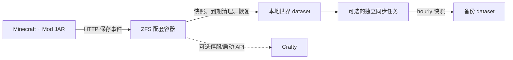

# Minecraft ZFS Backup

[English](README.md) | **简体中文**

一个服务端 Minecraft Mod：在存档保存完成后生成 ZFS 恢复点，通过独立的 Docker 配套容器执行 ZFS 操作。默认只需本地备份；异地同步和通过 Crafty 一键回滚均可按需接入。

**当前 Mod：** 2.2.0 · **Minecraft：** 1.21.1 · **NeoForge：** 21.1.251 · **Java：** 21

- [工作方式](#工作方式)
- [运行要求](#运行要求)
- [快速部署](#快速部署)
- [配置参考](#配置参考)
- [命令与回滚](#命令与回滚)
- [审计与持久状态](#审计与持久状态)
- [可选的存储同步](#可选的存储同步)
- [维护与排障](#维护与排障)
- [开发与更多文档](#开发与更多文档)

## 工作方式

将 Mod JAR 放入服务端的 `mods/` 目录，用 Docker Compose 部署配套容器。Mod 观察原版自动保存，等待受支持的保存队列完成，然后主动调用配套容器的 HTTP API。容器负责创建本地 ZFS 快照和到期清理。



| 快照类别 | 创建时机 | 默认本地保留规则 |
| --- | --- | --- |
| `mc-live-*` | 每轮成功的原版自动保存完成后；正常 20 TPS 下约每 5 分钟一次 | TTL 1 小时，正常约 12 份 |
| `mc-hourly-*` | 每个 UTC 小时中，首次成功的自动保存快照同时创建；按捕获开始时的小时分组 | TTL 24 小时，正常约 24 份定期快照 |
| 手动、正常停服、回滚恢复事件的 `mc-hourly-*` | 对应事件成功时 | TTL 24 小时；恢复保护 hold 可以延长实际保留时间 |

Live 和 hourly 是两份独立的原生 ZFS 快照，各自记录到期时间。同一轮自动保存需要创建两类快照时，共用一次已完成的存档保存屏障，不会再次强制保存世界。等待 HTTP 期间游戏继续运行；捕获期间会暂缓新的后台保存提交，并在完成或失败时恢复原保存标志。手动强制保存和第三方 Mod 的同步保存钩子仍可能耗时。

默认无人在线也会备份，因此强制加载区块的变化会被纳入。正常停服且确认保存、关闭成功后，可以再创建一份 hourly；强制结束进程无法发送这一退出事件。

TTL 根据实际 ZFS 创建时间计算，写入快照用户属性。配套容器在启动、提交快照后及独立定时器中执行清理，检查间隔最长约 60 秒。游戏停服后仍继续清理；容器重启后会处理已过期点。重启或修改 TTL 配置不会延长已有快照的绝对期限。真实 hold、回滚维护或快照繁忙可能推迟删除；保留策略按时间执行，并非硬性的份数上限。

部署由 Mod 和 Docker 配套容器完成，不安装本项目专用的 cronjob、systemd 单元，也不使用共享目录轮询通信。TrueNAS 和远端存储均为可选项。

## 运行要求

| 组件 | 要求 |
| --- | --- |
| 游戏服务端 | Minecraft 1.21.1 独立服务端、NeoForge 21.1.251、Java 21 |
| 宿主机 | Linux、OpenZFS 2.3，并提供 `/dev/zfs` |
| 世界存储 | 已挂载的独立 ZFS dataset，挂载根目录是包含 `level.dat` 的世界目录 |
| 容器环境 | Docker Engine 和 `docker compose` 插件 |
| 构建 Mod | Java 21 JDK；使用便携构建脚本时还需 Python 3.11+ |
| 可选的一键回滚 | Crafty API；已验证 Crafty 4.11.0，另需可写世界挂载与 ZFS block cloning |

配套镜像提供 Python 3.13 和 ZFS 2.3 用户态工具，ZFS 内核模块由宿主机提供。具体测试环境见[验证记录](docs/verification.md)。

每个配套容器管理一个配置指定的世界 dataset。部署前需自行准备或迁移该 dataset；程序会核对实际宿主机挂载路径，不会自动创建 dataset。子 dataset、外部数据库和世界 dataset 之外的文件不在该恢复点覆盖范围内。包含 BlueMap、配置等内容的整个 Minecraft 服务目录，可以另设 dataset 和备份策略。

## 快速部署

以下示例路径和 dataset 名称都应替换为你的实际配置：

| 用途 | 宿主机示例值 |
| --- | --- |
| Minecraft 服务端目录 | `/srv/minecraft` |
| 独立世界 dataset | `tank/minecraft-world` |
| 世界挂载路径 | `/srv/minecraft/world` |
| 配套容器配置 | `/srv/minecraft-backup/agent.json` |
| 配套容器持久状态 | `/srv/minecraft-backup/http-state` |
| 配套容器密钥目录 | `/srv/minecraft-backup/secrets` |

除非另有说明，命令均从仓库根目录执行。需要权限的初始化命令使用 `sudo`；已经是 root 时可省略。示例中的 Minecraft UID/GID 是 `1000:1000`，请替换为实际游戏进程的用户和组。

### 1. 获取源码并构建 Mod

```sh
git clone https://github.com/kevinmatthe/minecraft-zfs-backup.git
cd minecraft-zfs-backup

(cd mod && ./gradlew build)
```

Gradle 构建产物为 `mod/build/libs/local-zfs-backup-1.21.1-2.2.0.jar`。

也可以直接使用已有服务端的匹配依赖编译，并运行 Java 检查：

```sh
python3 mod/build.py \
  --libraries-dir /srv/minecraft/libraries \
  --java /path/to/jdk-21/bin/java
```

如果依赖和 JDK 位于已有游戏容器中：

```sh
python3 mod/build.py \
  --container YOUR_MINECRAFT_CONTAINER \
  --server-dir /path/to/server/inside/container
```

两种便携构建方式的产物均为 `mod/build/local-zfs-backup-1.21.1-2.2.0.jar`。按正常安装 Mod 的方式，将产出的 JAR 放入服务端 `mods/` 目录。本项目的 Compose 文件只负责部署配套容器。

使用 Gradle 产物时，宿主机安装示例为：

```sh
sudo install -m 0644 -o 1000 -g 1000 \
  mod/build/libs/local-zfs-backup-1.21.1-2.2.0.jar \
  /srv/minecraft/mods/local-zfs-backup-1.21.1-2.2.0.jar
```

便携构建时，将源文件改为其 `mod/build/` 下的产物路径。

### 2. 准备私有配置与 token

以下初始化命令用于新安装；升级时应保留已有 token 和持久状态。

```sh
sudo install -d -m 0700 /srv/minecraft-backup/secrets /srv/minecraft-backup/http-state
sudo install -m 0600 deploy/agent.example.json /srv/minecraft-backup/agent.json

sudo python3 - <<'PY'
import os
import secrets

fd = os.open('/srv/minecraft-backup/secrets/agent.token',
             os.O_WRONLY | os.O_CREAT | os.O_EXCL, 0o600)
with os.fdopen(fd, 'w') as output:
    output.write(secrets.token_hex(32) + '\n')
PY

sudo install -m 0600 -o 1000 -g 1000 \
  /srv/minecraft-backup/secrets/agent.token \
  /srv/minecraft/config/local-zfs-backup.token
sudo install -m 0644 -o 1000 -g 1000 \
  mod/local-zfs-backup.properties.example \
  /srv/minecraft/config/local-zfs-backup.properties
```

编辑 `/srv/minecraft-backup/agent.json`，将 `source_dataset` 和所有绝对路径改为实际宿主机值。本地备份配置示例：

```json
{
  "live_ttl_seconds": 3600,
  "hourly_ttl_seconds": 86400,
  "source_dataset": "tank/minecraft-world",
  "world_path": "/srv/minecraft/world",
  "state_dir": "/srv/minecraft-backup/http-state",
  "api_token_file": "/srv/minecraft-backup/secrets/agent.token",
  "min_interval_seconds": 60,
  "listen_host": "0.0.0.0",
  "listen_port": 8765
}
```

Mod 与配套容器中的 API token 内容必须一致。容器配置和 token 应由 root 所有、权限 `0600`，状态和密钥目录权限为 `0700`。Mod 自己的 token 副本需允许 Minecraft 用户读取。状态和密钥应保存在世界恢复范围之外。

### 3. 接入私有网络

创建双方共享的 Docker bridge：

```sh
docker network create minecraft-private
```

如果游戏已经运行在 Docker 中，将这个外部网络加入已有游戏服务的 Compose 配置，同时保留原网络。例如：

```yaml
services:
  minecraft:
    # 保留原有 image、volumes、ports 等配置。
    networks:
      - default
      - minecraft-backup
networks:
  default: {}
  minecraft-backup:
    external: true
    name: minecraft-private
```

按游戏服务原有部署流程应用网络变更。也可以暂时执行 `docker network connect minecraft-private YOUR_MINECRAFT_CONTAINER`，将已有容器接入；若需在容器重建后保持连接，仍应写入该服务的 Compose 文件。

Mod 默认连接 `http://minecraft-zfs-agent:8765`。配套容器中的世界 bind 必须保留**宿主机的完整绝对路径**，即使游戏容器内使用的是 `/data/world` 之类的其他路径。

### 4. 启动配套容器

```sh
cp deploy/.env.example .env
```

编辑 `.env`，与 `agent.json` 中的路径保持一致。只做本地快照时：

```dotenv
AGENT_CONFIG=/srv/minecraft-backup/agent.json
WORLD_PATH=/srv/minecraft/world
STATE_DIR=/srv/minecraft-backup/http-state
SECRETS_DIR=/srv/minecraft-backup/secrets
AGENT_NETWORK=minecraft-private
WORLD_READ_ONLY=true
```

```sh
docker compose --env-file .env -f deploy/compose.example.yaml config --quiet
docker compose --env-file .env -f deploy/compose.example.yaml up -d --build
docker compose --env-file .env -f deploy/compose.example.yaml ps
docker compose --env-file .env -f deploy/compose.example.yaml logs --tail 50 agent
```

Compose 会从本仓库在本机构建配套镜像。默认示例不向宿主机发布 API 端口。只有配套容器获得 `/dev/zfs` 和示例列出的能力；Minecraft 侧按通常方式安装 Mod JAR 和配置。

安装完 Mod 与配置后，启动或正常重启 Minecraft。使用 `/zfsbackup status`、`/zfsbackup save`、`/zfsbackup list` 验证。自动恢复点从下一轮成功的原版自动保存开始生成，不会在安装时补造历史。

### 游戏直接运行在宿主机时

沿用世界、配置和配套容器网络设置，跳过游戏容器接网步骤。为配套容器新增覆盖文件，例如 `/srv/minecraft-backup/compose.host.yaml`：

```yaml
services:
  agent:
    ports:
      - "127.0.0.1:8765:8765"
```

启动时使用两个 Compose 文件：

```sh
docker compose --env-file .env -f deploy/compose.example.yaml \
  -f /srv/minecraft-backup/compose.host.yaml up -d --build
```

Mod 配置改为 `agent_url=http://127.0.0.1:8765`，通过宿主机 loopback 连接 API；`/v1/` 接口仍需共享 token 鉴权。

## 配置参考

### Mod：`config/local-zfs-backup.properties`

```properties
agent_url=http://minecraft-zfs-agent:8765
agent_token_file=config/local-zfs-backup.token
freeze_timeout_seconds=15
only_if_players_been_online=false
snapshot_on_shutdown=true
```

| 参数 | 默认值 | 说明 |
| --- | --- | --- |
| `agent_url` | `http://minecraft-zfs-agent:8765` | HTTP(S) origin；不能包含凭据、query、fragment 或非根路径 |
| `agent_token_file` | `config/local-zfs-backup.token` | 普通 token 文件；相对于服务端根目录，也支持绝对路径 |
| `freeze_timeout_seconds` | `15` | 准备、保存屏障和快照的总时间预算，整数 `1`–`15` 秒 |
| `only_if_players_been_online` | `false` | 对自动和正常退出备份启用玩家活动过滤；手动备份不受影响。无人时区块仍变化的场景应保持 `false`。 |
| `snapshot_on_shutdown` | `true` | 确认保存、关闭成功后请求 hourly 快照，同时遵守活动过滤 |
| `interval_seconds` | 忽略 | 兼容旧配置；自动快照频率跟随原版自动保存 |

修改后重启 Minecraft。布尔值只接受 `true` 或 `false`。Token 至少包含 32 个可打印、非空白 ASCII 字符。TTL 在配套容器中配置，与存档保存频率分别控制。

### 配套容器：`agent.json`

| 字段 | 默认值 | 说明 |
| --- | --- | --- |
| `source_dataset` | 必填 | 固定的本地世界 dataset，例如 `tank/minecraft-world` |
| `world_path` | 必填 | 世界实际挂载的宿主机绝对路径，包含 `level.dat` |
| `state_dir` | 必填 | 世界恢复范围之外、root 所有、权限 `0700` 的持久状态目录 |
| `api_token_file` | 必填 | 世界恢复范围之外的私有 API token 绝对路径 |
| `live_ttl_seconds` | `3600` | Live 寿命；整数 `1`–`315360000` 秒 |
| `hourly_ttl_seconds` | `86400` | Hourly、手动、正常退出及恢复点寿命；范围同上 |
| `min_interval_seconds` | `60` | 接受普通快照请求的最小间隔，数值 `0`–`31536000` 秒；不会调度游戏保存 |
| `listen_host` | `0.0.0.0` | 容器内监听地址 |
| `listen_port` | `8765` | 整数 `1`–`65535`；修改时同步调整 Mod URL 和可选端口映射 |
| `crafty` | 无 | 可选的固定 Crafty 接入配置，见下方 |
| `keep` | `24`，忽略 | 已弃用的兼容字段，提供时仍需为正整数；清理按两类 TTL 分别执行 |

路径必须是规范的绝对路径，未知 JSON 字段会被拒绝。修改后重启配套容器。TTL 变更仅用于新初始化的快照元数据；已有快照的绝对期限不变。没有到期元数据的旧受管 hourly 点，按实际创建时间加 hourly TTL 初始化。

### Compose：`.env`

| 变量 | 说明 |
| --- | --- |
| `AGENT_CONFIG` | 宿主机私有 JSON 配置文件绝对路径 |
| `WORLD_PATH` | 世界 bind 的源和目标路径，与 JSON `world_path` 相同 |
| `STATE_DIR` | 状态 bind 的源和目标路径，与 JSON `state_dir` 相同 |
| `SECRETS_DIR` | 按同一绝对路径挂载的密钥目录，包含配置引用的 token 和证书 |
| `AGENT_NETWORK` | 已存在的外部 Docker 网络，供游戏/Crafty 按需共享 |
| `WORLD_READ_ONLY` | Compose 默认 `false`；仅快照可设 `true`，回滚需要 `false` |

JSON 路径与环境文件的 bind 路径必须一致。修改镜像、挂载或 Compose 环境插值后，通过 Compose 重建配套容器以应用。

### 可选的 `crafty` 配置

基础配置即可创建本地快照。启用 `/zfsbackup rollback` 时，在现有 JSON 中加入 `crafty` 对象，或参照[完整 Crafty 配置示例](deploy/agent.crafty.example.json)：

```json
{
  "crafty": {
    "base_url": "https://crafty.local:8443",
    "server_id": "00000000-0000-0000-0000-000000000000",
    "token_file": "/srv/minecraft-backup/secrets/crafty.token",
    "verify_tls": true,
    "ca_file": "/srv/minecraft-backup/secrets/crafty-ca.pem",
    "stop_timeout_seconds": 180,
    "start_timeout_seconds": 180
  }
}
```

| 字段 | 默认值 | 说明 |
| --- | --- | --- |
| `base_url` | 必填 | 配套容器可访问的固定 Crafty API 基础 URL |
| `server_id` | 必填 | 固定的一个 Crafty Minecraft 服务端 ID |
| `token_file` | 必填 | 独立、私有的 Crafty API token 绝对路径 |
| `verify_tls` | `true` | 校验 HTTPS 证书及主机名 |
| `ca_file` | 无 | 使用私有证书时信任的 CA/证书 PEM 文件 |
| `stop_timeout_seconds` | `180` | 确认停服的时间预算，数值 `1`–`3600` 秒 |
| `start_timeout_seconds` | `180` | 确认启动及就绪的时间预算，范围同上 |

使用仅绑定此服务端的 Crafty 专用账户。角色和 API key 均需 **COMMANDS** 与 **CONFIG** 权限（Crafty 4.11.0 中为 `10000010`）。Crafty token 与 Mod API token 分开保存；将其放入 `SECRETS_DIR`，权限 `0600`，需要时也将受信任证书放入该目录。私有 Docker DNS 别名需匹配证书 SAN 中明确列出的 DNS 名称。

将 `WORLD_READ_ONLY=false`，保留示例的 `rslave` 世界 bind，并重启配套容器。回滚还要求宿主机世界挂载能将快照自动挂载传播进容器；可用 `findmnt -o TARGET,PROPAGATION --target /srv/minecraft/world` 检查，具体见[部署说明](deploy/README.md)。恢复正式世界前，先用一次性测试世界验证配置。

## 命令与回滚

所有命令要求 **OP 权限等级 4**。游戏内使用前导 `/`，服务端控制台执行相同命令时可省略。

| 命令 | 行为 |
| --- | --- |
| `/zfsbackup save` | 强制保存一次并创建 hourly 恢复点，跳过玩家活动过滤 |
| `/zfsbackup now` | `save` 的别名 |
| `/zfsbackup status` | 本地快照流程与配套容器状态 |
| `/zfsbackup list` | 列出本地两类已发布快照、事件信息和 GUID |
| `/zfsbackup rollback <snapshot>` | 通过 Crafty 提交“停服 → 恢复 → 启动”任务 |
| `/zfsbackup rollback status` | 当前或最近一次回滚任务 |

快照请求遵守容器的最小接受间隔，同一时刻只执行一个流程。Mod 对失败或延期另有 60 秒退避。游戏内列表最多显示 64 条，Mod 的 HTTP 响应上限为 16 KiB；过大的快照目录列表可能超出这一限制。

在 `/zfsbackup rollback ` 后按 **Tab**，可补全本地真实快照名，支持 `mc-live-*`、`mc-hourly-*` 以及已输入的名称前缀。只保存在远端的恢复点通过存储系统另行管理。

命令接受后，由配套容器后台执行回滚：保护所选快照、禁用自动重启、通过 Crafty 停服、确认真实世界锁、创建回滚前恢复点、通过 block cloning 将数据恢复到当前世界 dataset、验证、创建完成恢复点、启动游戏并恢复原有自动重启策略。后续创建过的本地快照仍保留。

恢复或启动失败后，保留恢复点与维护状态供排查。重试前先检查任务状态；修复原因后，经过鉴权的管理员可调用 `POST /v1/rollbacks/<job-id>/resume`，显式继续当前失败任务，见 [HTTP API](docs/http-api.md)。进程中断的任务可在容器重启后恢复；标记为失败的任务需要显式续跑。未配置 `crafty` 时，快照和列表正常工作，回滚接口会提示未启用接入。

## 审计与持久状态

升级、替换容器时保留 `state_dir`：

| 文件 | 用途 |
| --- | --- |
| `ledger.json` | 快照/生命周期操作意图、去重与重启恢复 |
| `retention.json` | 最近一次本地清理结果 |
| `rollback.json` | 回滚任务、恢复状态和有限数量的已完成任务历史 |
| `rollback-audit.jsonl` | 独立追加的回滚审计，首次出现需要审计的请求时创建 |

审计记录已鉴权的请求和拒绝、最初发起者、快照及 GUID、执行阶段意图、恢复点、成功/失败、显式重试和容器重启续跑。Mod 从实际命令来源获取玩家姓名/UUID 或控制台标识，API 会标注为已认证客户端提供的身份声明。旧版 API 请求会记录为 API 来源。

每条审计记录都执行 fsync，文件权限为 `0600`。日志位于世界恢复范围之外，不会随存档回滚覆盖，也不随最近 64 个已完成任务的轮转删除。审计失败时阻止继续恢复；必要的安全停服补偿仍可执行，持久存储不可用时会明确跟踪证据缺口。详见[审计故障处理](agent/README.md#rollback-audit)。

## 可选的存储同步

默认部署只需要本地 ZFS。跨池、跨主机同步由存储平台另外配置；Mod 和配套容器都不执行同步，也不绑定池名或 TrueNAS。

在 TrueNAS 中，可另外配置原生复制任务：

| 设置 | 示例 |
| --- | --- |
| 源 | 配置的世界 dataset |
| 快照选择 | 额外命名规则 `mc-hourly-%Y%m%dT%H%M%SZ` |
| 任务调度 | 例如每 5 分钟检查有无新的 hourly |
| 目标保留策略 | Custom：1 周，由 TrueNAS 独立管理 |
| 目标 | 专用、只读的备份 dataset |
| Allow from scratch | 关闭 |

只复制已发布的 hourly，live 留在本地。复制任务的调度只是检查快照，不会触发游戏保存。本地删除和远端保留互相独立，因此本地 TTL 需要覆盖你期望容忍的复制故障窗口。

初次 GUID 核对、保留算法的时间/时区兼容性和增量共同基点处理，见[复制说明](deploy/replication.md)。包含 BlueMap、配置等内容的服务目录 dataset 可以有另一套独立原生策略。

## 维护与排障

读取持久状态，无需输出 token：

```sh
docker compose --env-file .env -f deploy/compose.example.yaml exec -T agent \
  python3 -m minecraft_zfs_agent --config /etc/minecraft-zfs-agent.json status
```

私有 API 提供 `GET /healthz`（仅就绪状态，无需 token）、`GET /v1/status` 和 `GET /v1/snapshots`（需要 bearer token）。快照 `created_at`、`expires_at` 是 Unix 秒，操作中以 `_ms` 结尾的时间是 Unix 毫秒。接入细节见 [HTTP API v1](docs/http-api.md)。

| 现象 | 检查项 |
| --- | --- |
| `source_unavailable` 或容器不健康 | `source_dataset` 是否对应实际挂载的宿主机 `world_path`；是否用了符号链接；`level.dat`、`/dev/zfs` 是否存在 |
| Bridge 被禁用或 HTTP 401 | 两份 token 是否一致；Mod token 是否是可读普通文件；容器 token/配置权限和属性值是否正确 |
| 没有新自动快照 | 等待完整成功的原版自动保存，检查游戏/容器日志和可选的玩家活动过滤 |
| 修改 `interval_seconds` 没效果 | 该旧参数已忽略；频率由原版自动保存决定 |
| 超过 12 份 live 或 24 份 hourly | 数量跟随 TTL 和保存节奏；手动、退出、恢复事件、真实 hold 和删除延迟都会影响数量 |
| 修改 TTL 后旧快照期限未变 | 已记录的绝对期限会保留；新 TTL 用于首次初始化元数据的快照 |
| 回滚未启用 | 配置 `crafty` 与可写世界 bind；快照功能可独立使用 |
| 恢复时快照目录看起来为空 | 检查宿主机挂载传播和容器的 `rslave` bind |
| `audit_unavailable` | 检查审计/状态目录权限、可用空间和最后一条记录完整性，处理时保留已有审计证据 |
| 回滚为 `FAILED` | 检查任务状态和保留的恢复点，修复原因后再显式续跑 |

升级时保留配置、token 和状态。正常停服后，用新 Mod JAR 替换旧版，重新构建/创建配套容器，启动 Minecraft 并验证恢复点。从旧 1.x 共享文件协议迁移时，参照 [HTTP 迁移说明](deploy/README.md)。

## 开发与更多文档

运行 Python 检查：

```sh
PYTHONPATH=agent python3 -m unittest discover -s agent/tests -v
```

Gradle 和便携构建都会运行 Java 检查。部分集成检查需要额外本机条件。涉及世界修改的验证应使用一次性 dataset 和独立游戏实例。

| 文档 | 内容 |
| --- | --- |
| [Mod 说明](mod/README.md) | 构建方式、保存/IO 接入与生命周期细节 |
| [配套容器说明](agent/README.md) | 本地保留、HTTP、Crafty 与审计持久化 |
| [部署说明](deploy/README.md) | Compose、挂载传播与 Crafty 配置 |
| [复制说明](deploy/replication.md) | 可选的 TrueNAS 原生复制 |
| [HTTP API](docs/http-api.md) | 事件、鉴权、快照/回滚请求与时间约束 |
| [协议概览](docs/protocol.md) | 保存屏障、提交与故障恢复模型 |
| [验证记录](docs/verification.md) | 已测试版本、真实链路验证和边界 |

## 许可证

[MIT](LICENSE)。
